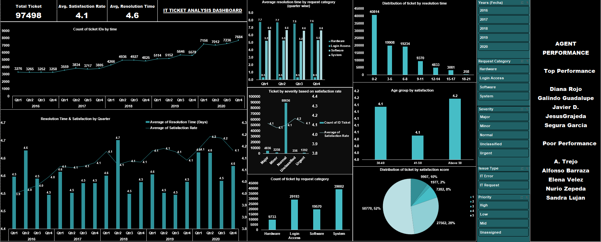

# IT TICKET ANALYSIS PROJECT (EXCEL)

An end-to-end Excel project that analyses 97,498 IT support tickets (2016-2020) to improve resolution time, agent performance and satisfaction.

## Project Overview
- Track ticket volume, resolution time and satisfaction over 5 years
- Compare agent performance and find training needs
- Find process gaps and give ranked recommendations
- Build a dynamic dashboard for management

## Data
- Tickets dataset: 97,498 records (category, issue type, severity, priority, resolution time, satisfaction, date)
- IT agents dataset: 50 agents

## Methodology
1. Data cleaning: fixed spelling errors (for example "Mayor" to "Major", "Unassiged" to "Unassigned")
2. Feature engineering: agent age from date of birth, helper columns
3. Analysis: pivot tables, VLOOKUP, correlation, trend analysis
4. Visualisation: pivot charts, slicers and a dashboard

## Key Insights
- Tickets grew 123% (13,051 to 29,088) but average resolution time stayed flat at about 4.55 days
- 30% of tickets (29,410) have no priority assigned
- Hardware (7.63 days) and System (6.62 days) are the slowest categories; Login Access takes only 0.31 days
- Average satisfaction rose from 3.98 to 4.16 and is about 4.10 overall
- Resolution time and satisfaction have a moderate negative correlation (r = -0.40), which does not prove causation

## Recommendations
1. Upgrade ticket software to auto-assign priority and routing
2. Train only the lowest-rated agents instead of the whole team
3. Fix Hardware and System tickets first
4. Add a chatbot or self-service for Login Access
5. Review hiring only if the load per agent rises sharply

## Tools
Microsoft Excel (pivot tables, pivot charts, slicers, VLOOKUP, CORREL), Word, PowerPoint

## Repository Contents
- Excel file: pivots, charts and dashboard
- Word file: questions and answers
- PowerPoint file: presentation
- Dashboard_Photo.png: dashboard preview

## Author
Palak Singh
An end-to-end Excel project that analyses 97,498 IT support tickets (2016-2020) to improve resolution time, agent performance and satisfaction.

## Project Overview
- Track ticket volume, resolution time and satisfaction over 5 years
- Compare agent performance and find training needs
- Find process gaps and give ranked recommendations
- Build a dynamic dashboard for management

## Data
- Tickets dataset: 97,498 records (category, issue type, severity, priority, resolution time, satisfaction, date)
- IT agents dataset: 50 agents

## Methodology
1. Data cleaning: fixed spelling errors (for example "Mayor" to "Major", "Unassiged" to "Unassigned")
2. Feature engineering: agent age from date of birth, helper columns
3. Analysis: pivot tables, VLOOKUP, correlation, trend analysis
4. Visualisation: pivot charts, slicers and a dashboard

## Key Insights
- Tickets grew 123% (13,051 to 29,088) but average resolution time stayed flat at about 4.55 days
- 30% of tickets (29,410) have no priority assigned
- Hardware (7.63 days) and System (6.62 days) are the slowest categories; Login Access takes only 0.31 days
- Average satisfaction rose from 3.98 to 4.16 and is about 4.10 overall
- Resolution time and satisfaction have a moderate negative correlation (r = -0.40), which does not prove causation

## Recommendations
1. Upgrade ticket software to auto-assign priority and routing
2. Train only the lowest-rated agents instead of the whole team
3. Fix Hardware and System tickets first
4. Add a chatbot or self-service for Login Access
5. Review hiring only if the load per agent rises sharply

## Tools
Microsoft Excel (pivot tables, pivot charts, slicers, VLOOKUP, CORREL), Word, PowerPoint

## Repository Contents
- Excel file: pivots, charts and dashboard
- Word file: questions and answers
- PowerPoint file: presentation
- Dashboard_image: dashboard preview
- Dashboard_video: dynamic dashboard

## Author
Palak Singh
